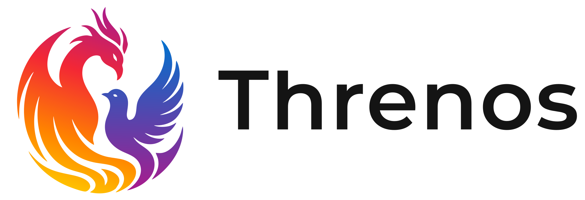

# <picture><source media="(prefers-color-scheme: dark)" srcset="images/threnos-lockup-dark.svg"></picture>

A process for building software that an agent or a person can delete and rebuild, one component at a time, without
losing what the software is supposed to do.

## The idea

With Agentic tooling, code is now cheap to write, and cheap to throw away. What is expensive is knowing what correct
means. So this process keeps that knowledge in a few small, slow-changing artifacts and treats the code as disposable.

| Permanent, changed deliberately                                | Disposable, rebuilt freely    |
| -------------------------------------------------------------- | ----------------------------- |
| Decisions (ADRs)                                               | Each component's code         |
| The domain model: the types components pass to each other      | Unit tests inside a component |
| Contracts: one per component, with fixtures and tests          |                               |
| Acceptance scenarios: the whole program, from outside, as data |                               |
| Dependency rules, as data                                      |                               |

A component is rebuilt by deleting its folder and regenerating it from its contract. A person reviews the rebuild by
reading test results, not code. That only works when the contract can tell a right implementation from a wrong one, so
most of the process is about making contracts strong and keeping their authors honest.

The idea comes from Chad Fowler's [Regenerative Software](https://aicoding.leaflet.pub/3majnyfydzs2y): interfaces,
behavior, and evaluations are permanent, and implementations are replaceable. The rate-of-change model borrows Stewart
Brand's pace layers.

## What is here

| Folder                            | Holds                                                                                                                                             |
| --------------------------------- | ------------------------------------------------------------------------------------------------------------------------------------------------- |
| [process/](process/README.md)     | The process, one topic per file, in the order you meet it                                                                                         |
| [rules/](rules/regenerative.md)   | The shared rules every agent follows on a project built this way                                                                                  |
| [skills/](skills/README.md)       | Agent skills that carry out parts of the process, vendor-neutral                                                                                  |
| [scaffold/](scaffold/)            | A flake template: `nix flake init -t <threnos>` gives a project its flake, justfile, and `.agents/threnos.toml`                                   |
| [docs/](docs/decisions/)          | Threnos's own decisions: the method ADRs. They explain the process and are not copied into projects                                               |
| [templates/](templates/README.md) | Starting files for a new project: `AGENTS.md`, a contract, a scenario, an ADR skeleton, product principles, issue templates, the dependency rules |
| [languages/](languages/README.md) | How the neutral structure maps to a language. Go is worked out; others are candidates                                                             |

## How a project uses it

A project holds its own settings and a read-only copy of the shared rules, side by side where agents already look:

```text
your-project/
  AGENTS.md                          Your settings and rules. You edit it
  CLAUDE.md                          Imports AGENTS.md and the shared rules
  .agents/
    rules/regenerative.md            The shared rules, copied from here. Read-only
    skills/                          The skills you copied from here
  docs/
    decisions/                       Your ADRs
    stack/                           Your language and tooling choices
```

The shared rules and the project's settings are separate files on purpose. A project can add rules in `AGENTS.md` and
cannot relax the shared ones. An update to the shared rules arrives as a new copy that shows up in the project's diff.
`AGENTS.md` names the rules file by path, because some search tools skip hidden folders. The process docs stay here,
since the rules and the project's own ADRs hold what an agent needs.

## Start a project

1. Read [principles](process/principles.md), [structure](process/structure.md), and the proposed
   [decomposition guidance](process/decomposition.md).
1. Run `nix flake init -t <threnos>` in the new repo, then `nix run .#sync`. That installs the
   [shared rules](rules/regenerative.md) and every [skill](skills/README.md) read-only into `.agents/`, links the skills
   for Claude Code, and seeds `AGENTS.md` and `CLAUDE.md` if the repo has none. Fill in the project settings in
   `AGENTS.md`.
1. Choose skills in `.agents/threnos.toml`: `on`, `off`, or `ejected`. See [skills/README.md](skills/README.md). Without
   Nix, copy the files by hand as that file describes.
1. Write the project's first records: product principles, from
   [templates/product-principles.md](templates/product-principles.md), and the stack and architecture choices that are
   the project's own. Copy the [record schema](templates/decision-record-front-matter.md) to `docs/reference/`. The
   method ADRs in [docs/decisions/](docs/decisions/) are Threnos's own and are not copied. A project's rules file
   carries what an agent needs from them.
1. Pick a language mapping from [languages/](languages/README.md), and record it in the project's stack docs. Copy the
   [Repowise guide](templates/repowise.md) to `docs/stack/repowise.md` and follow its local, no-model-spend setup.
1. Write the domain model, then the first contract, then build against it. [The lifecycle](process/README.md) gives the
   order.

## When it pays off

The process costs more up front than a single tree of code. It pays when:

- Agents write most of the code, and you want to bound the debt one bad run can add.
- Components have rich inputs, such as a file format, where a rebuild could quietly read things differently.
- The project will outlive its first implementation, or its first language.

It does not pay for a throwaway script, or for code whose correctness is mostly visual. Those are better judged by a
person using them.

## Projects that use Threnos

- [onboard-kit](https://github.com/8thlight/onboard-kit), a Go command-line tool.
- [repo-tutor](https://github.com/8thlight/repo-tutor), a Go command-line tool.

## Contributing

See [CONTRIBUTING.md](CONTRIBUTING.md) for what to check before a pull request.

## License

Copyright © 2026 8th Light, LLC. Licensed under the GNU General Public License, version 3 or later. See
[LICENSE](LICENSE).

8th Light® and the 8th Light logo are trademarks of 8th Light, LLC and are not covered by the GNU General Public
License.
