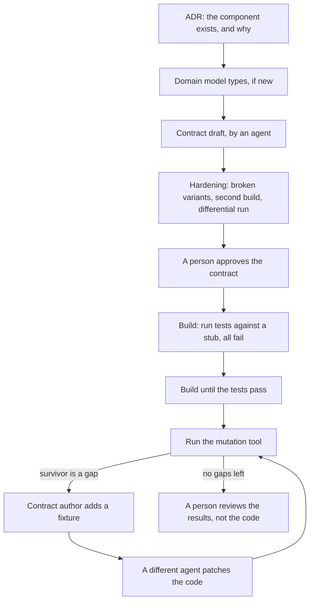

# The process

One topic per file. Read them in this order the first time.

| File                                             | Covers                                                                                                                |
| ------------------------------------------------ | --------------------------------------------------------------------------------------------------------------------- |
| [principles.md](principles.md)                   | The ideas everything else follows from                                                                                |
| [structure.md](structure.md)                     | Components, the domain model, contracts, acceptance, and the dependency rules                                         |
| [decomposition.md](decomposition.md)             | Proposed principles for choosing boundaries, using SRP, Clean Architecture, pace layers, and independent regeneration |
| [contracts.md](contracts.md)                     | What a contract holds, how it is drafted, and how it is made strong                                                   |
| [acceptance.md](acceptance.md)                   | Whole-program scenarios written as data                                                                               |
| [building.md](building.md)                       | Building and rebuilding a component, and when to regenerate                                                           |
| [mutation-testing.md](mutation-testing.md)       | Survivors as contract gaps, proving equivalence, the accepted list                                                    |
| [task-recipes.md](task-recipes.md)               | The justfile recipes that CI and agents call, with their arguments and output                                         |
| [judgment.md](judgment.md)                       | Principles documents, and the judges that apply them                                                                  |
| [review-and-approval.md](review-and-approval.md) | Who changes what, and what a reviewer reads                                                                           |
| [docs-and-decisions.md](docs-and-decisions.md)   | Where each kind of document goes, and how fast it changes                                                             |
| [working-with-agents.md](working-with-agents.md) | Briefing agents, delegated builds, and checking their reports                                                         |
| [issues.md](issues.md)                           | Cutting work into issues a person can review in one sitting                                                           |
| [lessons.md](lessons.md)                         | What went wrong on onboard-kit, and what changed because of it                                                        |

## The lifecycle of one component

A small component with a simple input skips hardening. Its draft goes straight to approval.

## The lifecycle of a change

- **A local defect.** Patch it in place. A failing test does not call for regeneration.
- **A behavior change.** Change the contract first, with a person's approval. Run the new tests against the existing
  component. A different agent from the test author patches it.
- **A design that has stopped working.** Regenerate the component from its contract.
- **A change to a type several components share.** Write an ADR, change the domain model, then update each affected
  contract.

[building.md](building.md#when-to-regenerate) has the rules in full.
